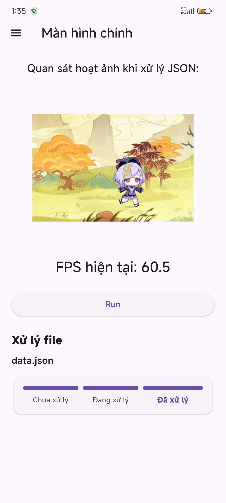
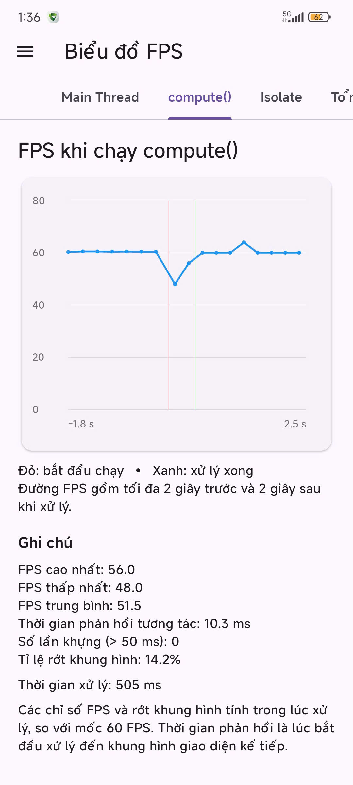

# FPS Isolate Benchmark (Flutter) 🚀

Ứng dụng đo lường, giám sát và trực quan hóa hiệu năng FPS (Frames Per Second) khi xử lý tác vụ nặng (Parse tệp JSON lớn > 15 MB) giữa **Main Thread (UI Thread)** và **Đa luồng (Background Isolate - `compute()` & `Isolate.spawn`)**.

---

## 1. Chạy thử nhanh

- **Tải [app-release.apk](app-release.apk)** ở ngay gốc repo (bên cạnh `README.md`).
- **Cài vào điện thoại Android**: Cho phép cài đặt ứng dụng từ nguồn ngoài khi hệ thống hiển thị thông báo nhắc.
- **Thao tác trong app**:
  1. Mở ứng dụng.
  2. Chọn **Generate** (mặc định 40 MB) hoặc bấm **Chọn tệp JSON** từ bộ nhớ thiết bị.
  3. Bấm **Run all modes 2 lần** (lần đầu là khởi động nóng để nạp cache và runtime, số liệu lấy lần sau).
- **Không cần cài đặt thêm bất kỳ môi trường nào**: Tệp APK (~48 MB – 50 MB, universal – chạy mọi ABI: arm64-v8a, armeabi-v7a, x86_64) được build trực tiếp từ mã nguồn trong repo; bản release mặc định được ký bằng debug key – thuận tiện và chấp nhận được cho bài demo học phần.

---

## 2. Ảnh / GIF demo

### Ảnh chụp màn hình ứng dụng thực tế trên thiết bị

| 1. Màn hình chính (UI & Animation) | 2. Biểu đồ FPS chi tiết (`compute`) | 3. So sánh Tổng quan (FPS & Jank) |
| :---: | :---: | :---: |
|  |  |  |
| *Hoạt ảnh mượt mà 60.5 FPS khi chưa tải và bảng trạng thái* | *Đường FPS ổn định quanh 60 FPS khi xử lý trong Isolate nền* | *So sánh trực quan: Main tụt về 0 FPS & 1 lần giật; Isolate đạt 58.9 FPS* |

> [!NOTE]
> *(Ảnh đầu README là biểu đồ gộp 3 đường sau khi bấm **Run all modes** lần 2, được chuẩn hóa theo quy cách: đường bậc thang 200 ms, tiêu đề 2 trục, nhãn chia 0,5 s, vạch dọc nét đứt tại 0s với chữ "start" trắng).*

```text
       Biểu đồ gộp 3 đường (FPS Timeline Overview)
FPS
 65 ┤
 60 ┼┈┈┈┈┈┈┈┈┈┈┈┈┈┈┈┈┈┈┈┈┈┈┈┈┈┈┈┈┈┈┈┈┈┈┈┈ compute (trắng) / Isolate (xanh)
    │                                     (duy trì ổn định quanh 60 FPS)
 30 ┼┈┈┈┈┈┈┈┈┈┈┈┈┈┈┈┈┈┈┈┈┈┈┈┈┈┈┈┈┈┈┈┈┈┈┈┈
    │
  0 ┼─────────┐                     ┌──── Main Thread (đỏ)
    │         │                     │     (tụt thẳng đứng về 0 FPS khi UI đóng băng)
    ┴─────────┼─────────────────────┼────────────────────────► Thời gian (s)
           -0.5s     0.0s (start)  +1.0s
```

---

## 3. Mục tiêu đề tài

- **So sánh Single-thread vs Multi-thread**: Đánh giá sự khác biệt trực quan và định lượng giữa xử lý đơn luồng trên UI thread và đa luồng trong Flutter.
- **Làm rõ bộ nhớ độc lập của Isolate**: Phân tích cơ chế cô lập Heap, giải thích vì sao biến dùng chung không bị ghi đè và tránh được race condition (xem mục 4).
- **Làm rõ cơ chế giao tiếp luồng**: Giải thích tường tận nguyên lý truyền thông điệp qua `SendPort`, `ReceivePort`, cơ chế zero-copy của `Isolate.exit`, và hàm tiện ích `compute()`.
- **Ứng dụng thực tế đo FPS giao diện**: Đo đạc và so sánh Main thread với Isolate khi parse tệp JSON dung lượng lớn (> 15 MB) trên Android Emulator / thiết bị thật.
- **Báo cáo kết quả toàn diện**: Sau mỗi lần chạy, cung cấp đầy đủ: Tổng thời gian (Wall time), FPS trung bình (FPS TB), FPS tối thiểu (FPS min), Khung hình dài nhất (Longest frame), Số khung hình Vsync bị bỏ lỡ (Missed vsync), và Biểu đồ FPS gộp trực quan theo thời gian.

---

## 4. Lý thuyết ngắn

Dart chạy toàn bộ mã của ứng dụng trong một isolate với một **Event Loop** duy nhất; cơ chế `async/await` **không tạo luồng mới**. Một tác vụ đồng bộ tốn CPU (như `jsonDecode` chuỗi 20–50 MB) đặt bên trong một hàm `async` vẫn sẽ chiếm dụng hoàn toàn CPU và chặn Event Loop $\rightarrow$ giao diện người dùng (UI) bị đứng hình hoàn toàn trong hàng trăm đến hàng nghìn mili-giây.

**Bộ nhớ độc lập (Isolated Memory)**: Mỗi isolate có một Heap riêng biệt; các biến top-level và static là bản sao độc lập của từng isolate; dữ liệu gửi qua `SendPort` đều được sao chép (deep copy) hoặc chuyển giao quyền sở hữu qua `Isolate.exit`:

```dart
int counter = 0; // Biến top-level: mỗi isolate sở hữu BẢN SAO RIÊNG BIỆT

void worker(SendPort p) {
  p.send(counter); // Worker thấy counter = 0 trong heap của nó, không phải giá trị của main
}

void main() async {
  counter = 42;
  final port = ReceivePort();
  await Isolate.spawn(worker, port.sendPort);
  final result = await port.first; // Nhận về 0!
}
```

📖 **Chi tiết lý thuyết chuyên sâu:** xem [docs/theory.md](docs/theory.md).

---

## 5. Kiến trúc & luồng dữ liệu

- **Parser tổng quát (`lib/parsefile.dart` / workers)**: Một hàm `parseJsonFile` tổng quát (chấp nhận mọi JSON hợp lệ, không phụ thuộc cấu trúc/schema cố định) dùng chung cho cả 3 chế độ.
- **Tối ưu truyền nhận dữ liệu**: Chỉ đường dẫn tệp (hoặc buffer cần thiết) được gửi vào isolate; kết quả trả về cho UI thread là đối tượng thống kê nhỏ gọn `ParseResult` (`JsonStats`: topLevel, nodes, maxDepth, thời gian từng pha).
- **Biểu đồ FPS gộp**: Gộp 3 đường tín hiệu; trục hoành X căn theo mốc bắt đầu tác vụ = `0.0 s`; chuỗi FPS tính theo từng ô **200 ms dạng bậc thang** (mỗi ô là một đoạn ngang liên tục; ô cuối cùng chưa đủ độ dài bị loại bỏ) $\rightarrow$ ô không có khung hình nào vẽ được sẽ có giá trị = 0 FPS, đường Main tụt về 0 thẳng đứng tương ứng chính xác khoảng thời gian đứng hình.
- **Bộ điều khiển làm nóng bộ nhớ (Cache Warming)**: Trước mỗi lần đo đạc, controller tự động "warm cache" bằng cách đọc tệp bất đồng bộ trong nền để chế độ chạy đầu tiên không bị thiệt thòi bởi thao tác đọc nguội (cold I/O read) từ bộ nhớ flash.

### Ý nghĩa hai trục của biểu đồ

| Đặc tả | Trục Y (Dọc) | Trục X (Ngang) |
| :--- | :--- | :--- |
| **Đại lượng** | **FPS** – Số khung hình vẽ được mỗi giây | **Thời gian (giây)** tính từ lúc bắt đầu tác vụ |
| **Tiêu đề trục** | `FPS (khung hình/giây)` | `Thời gian từ lúc bắt đầu tác vụ (giây)` |
| **Khoảng giá trị** | Cố định `0 → 65` (không tự co giãn) | Làm tròn ra ngoài về bội số của 0,5 (khoảng `−1,0 → 1,5`) |
| **Nhãn chia vạch** | `0, 15, 30, 45, 60` (không hiện nhãn 65) | Mỗi 0,5 s, 1 chữ số thập phân: `-0.5, 0.0, 0.5, 1.0, …` |
| **Ý nghĩa giá trị** | Mỗi điểm = (số frame trong ô 200 ms) × 5. Bình thường $\approx$ 60; 0 = giao diện đứng hình hoàn toàn | `0.0` = lúc bắt đầu chạy tác vụ (vạch “start”). Giá trị âm = giai đoạn nền trước khi chạy. Giá trị dương = trong lúc chạy tác vụ và ~0,5 s sau đó |
| **Đường tham chiếu** | Nét đứt tại **60** (mục tiêu mượt mà) và **30** (mức tối thiểu chấp nhận) | Vạch dọc nét đứt tại **0** ghi chữ **start** màu trắng |

> [!NOTE]
> Biểu đồ giả định màn hình 60 Hz tiêu chuẩn; trên thiết bị có tần số quét 90/120 Hz, số lượng khung hình sẽ cao hơn và “đường tham chiếu 60” không còn là mức tối đa.

📖 **Chi tiết thiết kế kiến trúc:** xem [docs/architecture.md](docs/architecture.md).

---

## 6. Chạy từ source

| Đối tượng | Cách chạy | Cần cài |
| :--- | :--- | :--- |
| **Người chỉ muốn xem demo** | Tải [app-release.apk](app-release.apk) ở gốc repo | Không cần cài gì thêm |
| **Người chạy từ source** | `git clone` $\rightarrow$ `flutter pub get` $\rightarrow$ `flutter run --profile` | Flutter SDK + thiết bị Android thật hoặc Android Emulator |

### Các lệnh chạy:

```bash
git clone https://github.com/Duy-OC/fps_isolate.git
cd fps_isolate
flutter pub get
flutter run --profile   # hoặc --release; ưu tiên thiết bị thật
```

- **Android Studio**: Chỉ là tùy chọn – công cụ tiện nhất để cài đặt Android SDK và tạo máy ảo Android Emulator (AVD).
- **Điện thoại thật**: Khuyên dùng cắm cáp USB (bật *Developer options* + *USB debugging*).
- **Lưu ý nền tảng**: Ứng dụng chỉ nhắm đến nền tảng **Android**. Flutter Web không hỗ trợ Isolate song song thật (hàm `compute()` trên Web chạy trực tiếp trên main thread) nên không hỗ trợ bản web.

---

## 7. Hướng dẫn sử dụng từng bước

1. **Chọn nguồn dữ liệu**:
   - **Generate**: Chọn kích thước `20 / 40 / 50 MB` (khuyến nghị **40 MB** – để thấy rõ hiện tượng đứng hình) $\rightarrow$ bấm **Generate**. Tệp sinh vào thư mục tạm với seed cố định (đảm bảo tính tái lập), không commit lên git.
   - **Chọn tệp JSON**: Chọn bất kỳ tệp `.json` nào có trên bộ nhớ máy. Tệp `> 100 MB` sẽ hiển thị hộp thoại xác nhận; tệp `< 15 MB` hiển thị cảnh báo nhỏ (hiện tượng jank có thể không đủ rõ) nhưng không chặn người dùng.
2. **Chọn chế độ chạy**:
   - Chọn một trong các chế độ: **Main thread** / **compute()** / **Isolate (SendPort)**.
   - Bấm **Run** (chạy 1 chế độ được chọn) hoặc bấm **Run all modes** (tự động chạy tuần tự: Main $\rightarrow$ compute $\rightarrow$ Isolate, nghỉ 1 s giữa các lần đo).
   - Ở chế độ Main thread, hệ thống sẽ hiện dòng cảnh báo: *“UI sẽ đứng hình vài giây…”* – **lưu ý: không chạm vào màn hình trong lúc tác vụ đang chạy**.
   - **Khuyến nghị**: Bấm **Run all modes 2 lần** – lần đầu là khởi động nóng (warm-up run), lấy số liệu đo đạc ở lần thứ hai.
3. **Đọc và đối chiếu kết quả**:
   - **Biểu đồ gộp**: Màu đỏ = Main (tụt về 0 FPS = đứng hình), Màu trắng = `compute()`, Màu xanh = `Isolate`; phần legend đi kèm chỉ số "frame dài nhất" của từng chế độ; vạch "start" = thời điểm bắt đầu tác vụ.
   - **Bảng ResultCard**: Hiển thị Wall time (tổng thời gian), FPS TB/min, Frame dài nhất, Jank count, Vsync bỏ lỡ, Số lượng Nodes, và thời gian chi tiết các pha `read / decode / walk`.
   - Bấm nút **Copy Markdown** để sao chép kết quả và dán vào [docs/benchmark_results.md](docs/benchmark_results.md).
   - Ở chế độ **Isolate (SendPort)**: Giao diện hiển thị thanh tiến độ ba giai đoạn (`read` $\rightarrow$ `decode` $\rightarrow$ `walk`) – đây là ưu thế vượt trội của `Isolate.spawn` so với `compute()`.

---

## 8. Nguồn dữ liệu và giới hạn đầu vào

- **Generate 20 / 40 / 50 MB (khuyến nghị 40 MB)**: Sinh mảng đối tượng JSON mẫu lớn với seed ngẫu nhiên cố định = `42`.
- **Chọn tệp JSON bất kỳ**: Bộ phân tích cú pháp không phụ thuộc vào cấu trúc cố định – chấp nhận mọi dữ liệu JSON hợp lệ theo chuẩn UTF-8 (gốc là Object, Array hoặc Scalar).
- **Dung lượng khuyến nghị**: Từ **15 MB đến 100 MB** để hiện tượng giật lag/đóng băng thể hiện rõ nét trong khi vẫn đảm bảo dung lượng RAM hợp lý. Tệp 50 MB sau khi parse có thể chiếm dụng đáng kể bộ nhớ (cây đối tượng JSON trong Heap + bản sao ở Isolate).
- **Phạm vi kiểm thử**: Ứng dụng tập trung đo lường thời gian phân tích cú pháp và chỉ số FPS của giao diện – không can thiệp thẩm định ngữ nghĩa nội dung JSON.
- **Xử lý ngoại lệ**: Nếu tệp JSON bị lỗi cú pháp, ứng dụng bắt ngoại lệ `FormatException`, hiển thị thông báo qua `SnackBar` thân thiện và tuyệt đối không gây crash ứng dụng.

---

## 9. Kết quả benchmark

> [!IMPORTANT]
> Toàn bộ số liệu công bố phải do ứng dụng đo lường thực tế trên thiết bị. Xem chi tiết tại [docs/benchmark_results.md](docs/benchmark_results.md).

- **Phương pháp đo**: Bấm **Run all modes** từ 3 đến 5 lần, lấy giá trị **trung vị (median)**; ghi nhận đầy đủ: Model điện thoại/máy ảo, Chế độ build (`--profile` / `--release`), Phiên bản Flutter & Dart, và Kích thước tệp JSON.
- **Lưu ý về máy ảo**: Nếu thực hiện đo trên Android Emulator, giá trị thời gian tuyệt đối có thể không phản ánh chính xác 100% phần cứng máy thật, nhưng tỷ lệ tương quan so sánh giữa 3 chế độ (Main vs compute vs Isolate) vẫn hoàn toàn chuẩn xác và có giá trị khoa học.

*(Bảng số liệu chi tiết và ảnh biểu đồ chụp từ thiết bị thực tế được lưu trữ trong [docs/benchmark_results.md](docs/benchmark_results.md)).*

---

## 10. Phân tích, kết luận, hạn chế

- **Main thread**: Do Event Loop bị chiếm dụng liên tục trong toàn bộ thời gian parse JSON, UI Thread không thể xử lý tín hiệu Vsync; đường tín hiệu màu đỏ trên biểu đồ tụt dốc không phanh về **0 FPS** trong suốt thời gian tác vụ chạy; ghi nhận khung hình dài nhất lên đến hàng nghìn mili-giây.
- **`compute()` / Isolate**: Tách toàn bộ tác vụ giải mã nặng sang luồng nền độc lập; Main thread hoàn toàn thảnh thơi để tiếp tục duy trì hoạt ảnh mượt mà ở mức **$\approx$ 60 FPS**; chi phí phụ trội chỉ là việc spawn luồng và chuyển giao kết quả `ParseResult` nhỏ gọn (chi phí gần như bằng 0 nhờ cơ chế `Isolate.exit`).

### Hạn chế cần biết:
1. **Chi phí khởi tạo Isolate**: Việc spawn một isolate mới tiêu tốn từ vài đến vài chục ms – do đó isolate không mang lại lợi ích cho các tác vụ tính toán quá ngắn (< 5 ms).
2. **Chi phí sao chép bộ nhớ**: Việc truyền dữ liệu đối tượng có kích thước lớn qua `SendPort` mà không dùng `Isolate.exit` sẽ tiêu tốn thời gian sao chép tỉ lệ thuận với kích thước dữ liệu.
3. **Giao tiếp tầng nền tảng (Platform Channels)**: Các plugin hoặc thư viện phụ thuộc platform channel cần cấu hình `RootIsolateToken` nếu muốn gọi từ Background Isolate.
4. **Flutter Web**: Không có isolate song song thực sự do tính chất đơn luồng của runtime JavaScript trên trình duyệt.
5. **Nút thắt hiển thị (Build/Paint)**: Isolate giải phóng CPU cho việc tính toán logic, nhưng không thể giải quyết được tình trạng drop frame nếu chính widget tree của bạn quá nặng khi render.

---

## 11. Tài liệu tham khảo & giấy phép

- 📖 [docs/theory.md](docs/theory.md) – Lý thuyết chuyên sâu về Isolate & Event Loop trong Dart.
- 📐 [docs/architecture.md](docs/architecture.md) – Kiến trúc hệ thống, quy cách biểu đồ và luồng dữ liệu.
- 📊 [docs/benchmark_results.md](docs/benchmark_results.md) – Kết quả đo đạc thực nghiệm và bảng thông số.
- 🔗 [Dart Documentation – Concurrency & Isolates](https://dart.dev/language/concurrency)
- 🔗 [Flutter Documentation – Profiling Flutter apps](https://docs.flutter.dev/perf/ui-performance)
- 🔗 [Flutter API – `compute` function](https://api.flutter.dev/flutter/foundation/compute-constant.html)

**Giấy phép (License)**: Dự án được phân phối dưới giấy phép [MIT](LICENSE).
