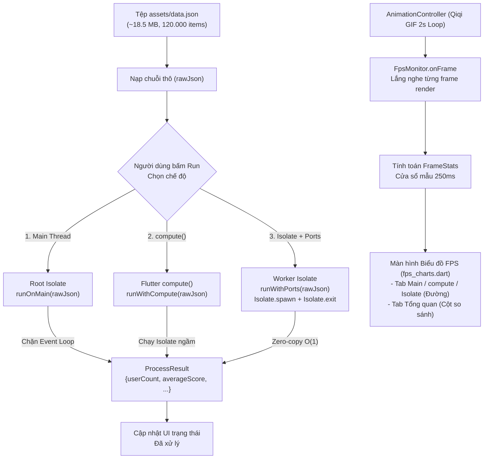

# Kiến trúc Hệ thống & Luồng Dữ liệu (Architecture & Data Flow)

Tài liệu này mô tả chi tiết kiến trúc các thành phần trong ứng dụng, luồng dữ liệu khi phân tích cú pháp tệp JSON lớn và nguyên lý đo lường FPS của engine `FpsMonitor`.

---

## 1. Sơ đồ Kiến trúc & Luồng Dữ liệu

Ứng dụng phân chia rõ rệt giữa giao diện người dùng (UI), engine giám sát khung hình (FPS Monitor) và các chiến lược xử lý tính toán ngầm (Run Modes):

---

## 2. Chi tiết các Thành phần Mã nguồn

### 2.1. Phân tích cú pháp (`lib/parsefile.dart`)
- **`processLargeJson(String rawJson)`**:
  - Nhận chuỗi JSON thô và thực thi hàm `jsonDecode(rawJson)`.
  - Duyệt tuần tự qua 120.000 bản ghi để tính toán:
    - Tổng điểm (`totalScore`) $\rightarrow$ Điểm trung bình (`averageScore`).
    - Đếm số lượng người dùng tại thành phố `'Da Nang'` (`daNangCount`).
    - Đếm tổng số lượng thẻ (`tagCount`).
  - Trả về đối tượng `ProcessResult` (Map chứa các con số tổng hợp).
  - Vì kết quả trả về chỉ là một Map 4 phần tử rất nhỏ, việc chuyển giao qua Isolate không tốn kém tài nguyên.

### 2.2. Các chế độ thực thi (`lib/runmodes.dart`)
- **`runOnMain`**:
  - Chạy hàm `processLargeJson` ngay trên Root Isolate.
  - Toàn bộ CPU của UI thread bị chiếm dụng $\rightarrow$ Giao diện đứng hình hoàn toàn.
- **`runWithCompute`**:
  - Gọi hàm `compute(processLargeJson, rawJson)`.
  - Flutter tự động spawn một isolate tạm thời, nạp đối số, đợi kết quả và giải phóng isolate sau khi hoàn thành.
- **`runWithPorts`**:
  - Gọi `Isolate.spawn` để khởi tạo worker isolate thủ công.
  - Nhận kết quả qua `receivePort.first`.
  - Worker kết thúc bằng `Isolate.exit(sendPort, result)`, tận dụng cơ chế **zero-copy transfer** chuyển giao vùng nhớ Map kết quả sang Root Isolate tức thời mà không tốn chi phí deep copy.

### 2.3. Engine giám sát FPS (`lib/fps_monitor.dart`)
- **Cơ chế đo lường**:
  - Đăng ký listener vào `AnimationController` đang chạy lặp vô tận. Mỗi khi Flutter vẽ một frame, hàm `onFrame()` được gọi và ghi nhận timestamp hiện tại (`microseconds`).
  - Cửa sổ lấy mẫu chuẩn: **250 ms** (`fpsSampleWindowUs = 250000`).
- **Phân tách giai đoạn xử lý và hồi phục**:
  - Khi bắt đầu chạy benchmark (`beginTrial`), monitor ghi nhận mốc thời gian bắt đầu ($t = 0$).
  - Khi xử lý xong (`markProcessingComplete`), monitor ghi nhận thời gian xử lý (`processingUs`).
  - `buildFrameStats`: Tách riêng các ô (buckets) thuộc khoảng thời gian xử lý (`processingBucketCount = processing ~/ 250000`) và khoảng thời gian hồi phục sau xử lý (`recoveryBucketCount`).
  - Nhờ đó, các frame hồi phục sau khi tác vụ hoàn thành không bị tính gộp hay vẽ ngược vào khoảng thời gian Main Thread đang bị đơ.

### 2.4. Trực quan hóa dữ liệu (`lib/fps_charts.dart`)
- **Biểu đồ đường (`_FpsLinePainter`)**:
  - Vẽ biến thiên FPS từ 2 giây trước khi chạy đến 2 giây sau khi kết thúc.
  - Vạch đứng màu đỏ: Thời điểm bắt đầu xử lý ($t = 0.0\text{ s}$).
  - Vạch đứng màu xanh lá: Thời điểm xử lý xong ($t = \text{processingMs}/1000$).
  - Đường nối và các điểm tròn biểu diễn giá trị FPS thực tế qua từng cửa sổ thời gian.
- **Biểu đồ cột tổng quan (`_ComparisonPainter`)**:
  - Tự động hiển thị khi người dùng đã chạy cả 3 chế độ.
  - So sánh trực quan 3 đại lượng cốt lõi:
    1. **FPS trung bình**: Main Thread (0.0 FPS) vs compute() (~51 FPS) vs Isolate (~59 FPS).
    2. **Số lần giật (> 50 ms)**: Main Thread (1 lần lớn) vs compute() (0 lần) vs Isolate (0 lần).
    3. **Tỉ lệ rớt khung hình (%)**: Main Thread (100%) vs compute() (~14%) vs Isolate (~1.5%).

### 2.5. Bảng phân trang tối ưu RAM (`lib/result_table.dart`)
- Sử dụng `PaginatedDataTable` hiển thị dữ liệu người dùng.
- Cơ chế `_UserDataSource` duyệt qua vị trí ký tự xuống dòng `\n` trong chuỗi `rawJson` để xác định vị trí bắt đầu của từng dòng, chỉ gọi `jsonDecode` cho 10 bản ghi của trang đang xem.
- Không giữ 120.000 đối tượng Map trong bộ nhớ RAM, tránh gây quá tải bộ nhớ trên thiết bị di động.
