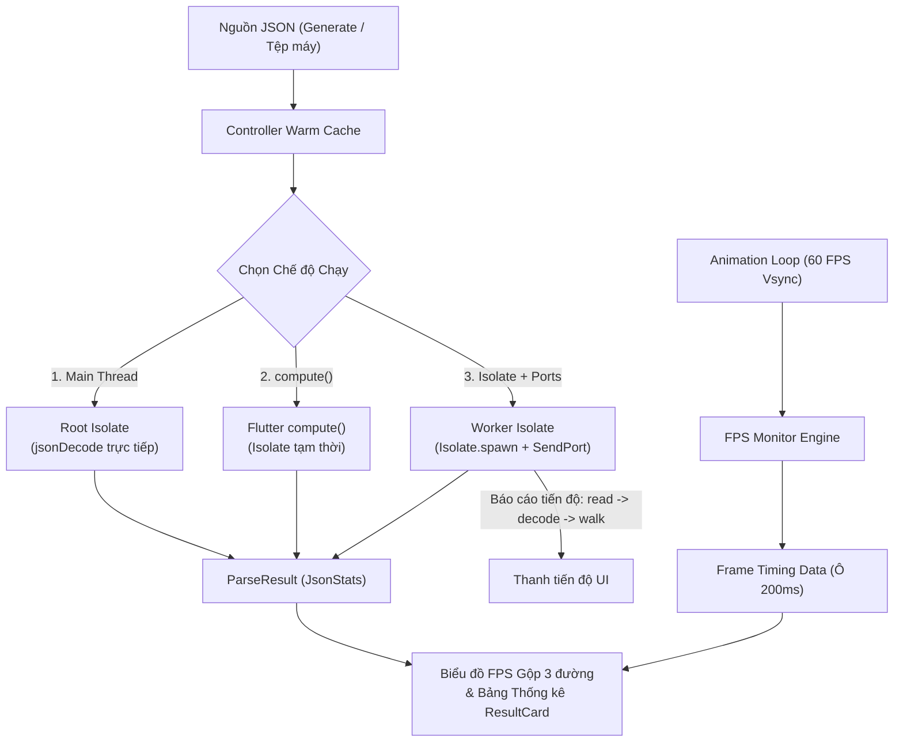

# Kiến trúc Hệ thống & Luồng Dữ liệu (Architecture & Data Flow)

Tài liệu này mô tả chi tiết kiến trúc luồng dữ liệu, cơ chế đo lường FPS, cách tổ chức worker parsing JSON và thiết kế toán học của hệ tọa độ biểu đồ FPS gộp.

---

## 1. Tổng quan Kiến trúc

Ứng dụng được thiết kế theo mô hình phân tách rõ ràng giữa thành phần giao diện (UI), engine giám sát khung hình (FPS Monitor) và các chiến lược xử lý tính toán nền (Run Modes & Workers):

---

## 2. Luồng Dữ liệu & Quy trình Đo lường

### 2.1. Khởi động nóng & Warm Cache (Cache Warming)
- Khi đọc tệp lớn từ ổ cứng lần đầu tiên, hệ điều hành cần nạp dữ liệu từ bộ nhớ flash vào File System Page Cache (Cold Read). Chế độ chạy đầu tiên nếu gặp phải tình trạng này sẽ bị kéo dài thời gian I/O một cách thiếu công bằng.
- **Giải pháp**: Trước khi bắt đầu đo đạc chính thức, Controller thực hiện thao tác **Warm Cache** bằng cách đọc tệp bất đồng bộ trong nền. Nhờ đó, cả 3 chế độ đo đều có điều kiện đọc tệp từ RAM cache công bằng như nhau.
- Ngoài ra, ứng dụng khuyến nghị người dùng bấm **Run all modes 2 lần** (lần đầu để JIT/AOT khởi động các cơ chế cấp phát bộ nhớ, số liệu chính thức ghi nhận ở lần 2).

### 2.2. Module Parse JSON Tổng quát
- Hàm parser được thiết kế tổng quát, chấp nhận mọi JSON UTF-8 hợp lệ mà không phụ thuộc vào bất kỳ schema cố định nào (hỗ trợ cả JSON Object lớn, JSON Array hoặc dữ liệu lồng nhau nhiều tầng).
- **Tối ưu truyền nhận dữ liệu**:
  - Chỉ truyền đường dẫn tệp (hoặc buffer chuỗi nhỏ) vào Isolate con thay vì dữ liệu cồng kềnh.
  - Kết quả trả về cho UI thread là đối tượng thống kê gọn nhẹ `ParseResult` (gồm `topLevelCount`, `totalNodes`, `maxDepth`, thời gian các pha `readMs`, `decodeMs`, `walkMs`).
  - Isolate con sử dụng `Isolate.exit()` để hoàn thành trả kết quả tức thời mà không tốn chi phí deep copy.

### 2.3. Cập nhật tiến độ ở Isolate Mode
Khác với `compute()` chỉ có thể gửi kết quả một lần duy nhất khi kết thúc hàm:
- Chế độ **Isolate (SendPort)** mở một kênh `ReceivePort` lắng nghe các gói tin trạng thái từng pha:
  1. `read`: Đang đọc tệp từ ổ đĩa vào bộ nhớ.
  2. `decode`: Đang phân tích cú pháp chuỗi JSON thành đồ thị đối tượng Dart.
  3. `walk`: Đang duyệt cây đối tượng để thống kê nút và độ sâu.
- Giao diện người dùng hiển thị một thanh tiến độ trực quan tương ứng với từng giai đoạn này.

---

## 3. Thiết kế Biểu đồ FPS Trực quan hóa

Biểu đồ gộp 3 đường (Main thread màu đỏ, `compute()` màu trắng, `Isolate` màu xanh) được xây dựng tùy biến trên canvas với các tiêu chuẩn trực quan khắt khe:

### 3.1. Căn chỉnh trục thời gian (Time Normalization)
- Mốc bắt đầu tác vụ được chuẩn hóa về **$t = 0.0\text{ s}$**.
- Các khung hình vẽ trước thời điểm bắt đầu tác vụ có giá trị thời gian âm ($t < 0$), thể hiện trạng thái ổn định nền của ứng dụng trước khi chịu tải.
- Các khung hình vẽ trong khi chạy tác vụ và khoảng 0,5 giây sau đó có giá trị thời gian dương ($t > 0$).

### 3.2. Chuỗi FPS theo ô 200 ms dạng bậc thang (Step-Ladder Bins)
- Dữ liệu khung hình được gom nhóm theo từng cửa sổ thời gian cố định **200 ms** (Sample Window).
- FPS tại mỗi ô được tính:
  $$\text{FPS} = (\text{Số frame vẽ được trong ô 200 ms}) \times 5$$
- Biểu đồ được vẽ theo dạng **đường bậc thang (step-ladder line)**: mỗi ô thời gian tương ứng với một đoạn thẳng nằm ngang liên tục trong suốt 200 ms của nó.
- Nếu Main thread bị kẹt trong suốt 200 ms đó mà không vẽ được khung hình nào $\implies$ số frame = 0 $\implies$ **đường đỏ tụt thẳng đứng về 0 FPS**, thể hiện rõ ràng và trực quan khoảng thời gian UI bị đứng hình hoàn toàn.
- Ô thời gian cuối cùng chưa đủ độ dài 200 ms sẽ được loại bỏ để tránh sinh ra giá trị FPS giả.

### 3.3. Quy cách Hai Trục Tọa độ

| Đặc tả | Trục Y (Tung độ - Dọc) | Trục X (Hoành độ - Ngang) |
| :--- | :--- | :--- |
| **Đại lượng** | FPS – Số khung hình vẽ được mỗi giây | Thời gian (giây) tính từ lúc bắt đầu tác vụ |
| **Tiêu đề trục** | `FPS (khung hình/giây)` | `Thời gian từ lúc bắt đầu tác vụ (giây)` |
| **Khoảng giá trị** | Cố định từ `0` đến `65` (không tự co giãn theo dữ liệu) | Làm tròn ra ngoài về bội số của 0,5 s (ví dụ: khoảng `[-1.0, 1.5]`) |
| **Nhãn chia vạch** | Các mốc cố định: `0`, `15`, `30`, `45`, `60` (không hiển thị nhãn 65) | Mỗi bước 0,5 s với 1 chữ số thập phân: `-0.5`, `0.0`, `0.5`, `1.0`, … |
| **Ý nghĩa giá trị** | Bình thường duy trì quanh `60`. Về `0` nghĩa là giao diện tê liệt hoàn toàn. | `0.0` là lúc bắt đầu chạy tác vụ. Bên trái vạch là giai đoạn nền, bên phải là giai đoạn tải. |
| **Đường tham chiếu** | Đường nét đứt màu xám tại mốc `60` (mục tiêu) và `30` (ngưỡng tối thiểu chấp nhận được). | Vạch dọc nét đứt tại hoành độ `0.0` kèm nhãn chữ **"start"** màu trắng. |

> [!NOTE]
> Biểu đồ chuẩn hóa trên màn hình 60 Hz tiêu chuẩn. Đối với các thiết bị có tần số quét cao (90 Hz, 120 Hz ProMotion), số lượng khung hình trong ô 200 ms sẽ cao hơn tương ứng và đường tham chiếu 60 đóng vai trò là mốc chuẩn tối thiểu cho độ mượt mà.
